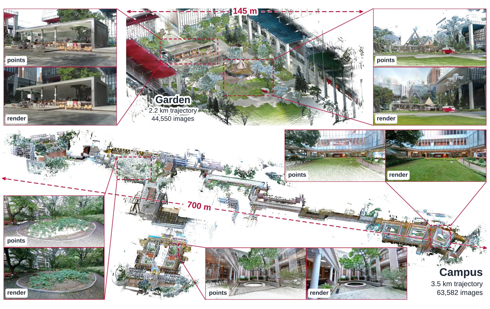
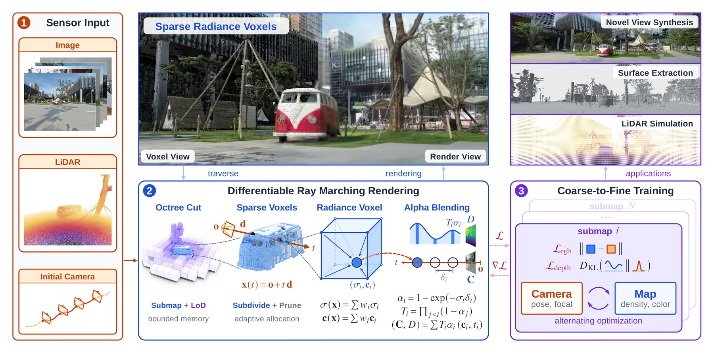

# SpaRV: Sparse Radiance Voxels for Scalable Geometrically Consistent LiDAR-Visual Mapping and Rendering

[](https://arxiv.org/abs/2610.25665)

[Project Page](https://jianhengliu.github.io/Projects/SpaRV/) | [Paper](https://arxiv.org/abs/2610.25665)

### News
- 2026/10: The project page is online. The code will be released in this repository after the paper is accepted.

## 1. Introduction


**TL;DR:** SpaRV builds a sparse radiance voxel map from LiDAR and cameras that stays geometrically consistent away from the captured trajectory, optimizes the camera poses and focal lengths against the map, and reconstructs a university campus captured in 63,582 images on a single 24 GB GPU.

SpaRV represents the scene as a **Spa**rse **R**adiance **V**oxel map and renders it by differentiable ray marching, so camera pixels and LiDAR rays supervise the map through one renderer. The figure above shows Garden (2.2 km trajectory, 44,550 images) and Campus (3.5 km trajectory, 63,582 images); each close-up compares the LiDAR point cloud with the SpaRV rendering from the same free viewpoint.



- **Ray-marching rendering of sparse radiance voxels.** A differentiable ray marcher on an adaptive octree lets camera pixels, LiDAR rays, and rays of non-pinhole (fisheye, omnidirectional) cameras supervise the map.
- **Geometry-grounded map training.** LiDAR depth supervision, occupied voxel guidance, and normal and smoothness regularizers keep the geometry consistent beyond the captured trajectory.
- **Map-driven camera optimization.** Map training alternates with photometric optimization of the camera poses and focal lengths, which reduces the texture blur caused by residual camera errors.
- **Large-scale reconstruction under bounded GPU memory.** One octree and one granularity-driven cut serve both training and rendering: the submap in focus is held at full resolution and the rest of the scene at coarser levels.

The trained maps also support novel view synthesis, surface extraction, and the simulation of other camera and LiDAR models.

## 2. Code

The paper is under review. The implementation will be open-sourced here after acceptance. Watch or star this repository to get notified.

## 3. Citation

If you find SpaRV useful in your research, please cite:

```bibtex
@misc{liu2026sparv,
  title   = {SpaRV: Sparse Radiance Voxels for Scalable Geometrically Consistent LiDAR-Visual Mapping and Rendering},
  author  = {Liu, Jianheng and Wan, Yunfei and Cheng, Fangming and Hong, Xiangyu and Zou, Zuhao and
             Li, Haotian and Yin, Longji and Zheng, Chunran and Lin, Jiarong and Zhang, Fu},
  year    = {2026},
  eprint  = {2610.25665},
  archivePrefix = {arXiv},
  primaryClass  = {cs.RO},
  url     = {https://arxiv.org/abs/2610.25665}
}
```

## 4. License

This project is released under the [GPL-3.0 License](LICENSE).
